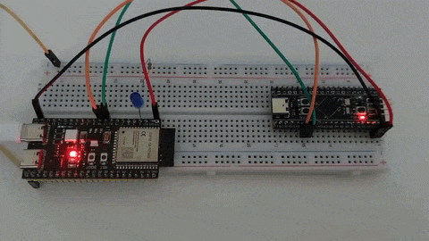

# UART: ESP32-S3 ↔ STM32 (Black Pill)

Обмін повідомленнями між двома мікроконтролерами через UART.

## Опис

Кожна плата має кнопку та світлодіод. Натискання кнопки на одній платі надсилає рядок `hello\n` по UART, а друга плата за цим рядком перемикає свій світлодіод.

| Плата | Кнопка | Світлодіод |
|---|---|---|
| ESP32-S3 (N16R8) | BOOT (GPIO0) | зовнішній, GPIO4 |
| STM32F401/F411 (Black Pill) | KEY (PA0) | вбудований, PC13 |

## Демонстрація

## Підключення

| ESP32-S3 | STM32 |
|---|---|
| GPIO17 (TX) | PA10 (RX) |
| GPIO18 (RX) | PA9 (TX) |
| GND | GND |

Параметри UART: 115200, 8N1, без flow control. Рівні логіки 3.3 В.

## Як працює

- Прийом: байти накопичуються до `\n`, після чого рядок порівнюється з `hello`.
- Кнопки: програмний дебаунс 30 мс, подія генерується один раз на натискання.
- ESP32: ESP-IDF, драйвер `uart`, опитування в циклі без блокування.
- STM32: HAL, прийом по перериванню (`HAL_UART_Receive_IT`), налаштування в STM32CubeMX.
