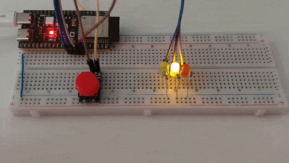

# Світлофор на ESP32-S3

Домашнє завдання з реалізації світлофора на ESP32-S3 з використанням ESP-IDF та PlatformIO.

Для керування режимами світлофора використовується скінченна машина станів.
Натискання кнопки обробляється за допомогою GPIO-переривання.

## Демонстрація

## Стандартний режим

Світлофор перемикає сигнали в такій послідовності:

1. **Зелений** — рух дозволено.
2. **Зелений миготливий** — попередження про завершення дозволеного сигналу.
3. **Жовтий** — рух заборонено, підготовка до зміни сигналів.
4. **Червоний** — рух заборонено.
5. **Червоний і жовтий** — підготовка до ввімкнення зеленого сигналу, рух ще заборонено.
6. **Зелений** — цикл повторюється.

## Спеціальний режим

За натисканням кнопки вмикається **жовтий миготливий сигнал**. 

