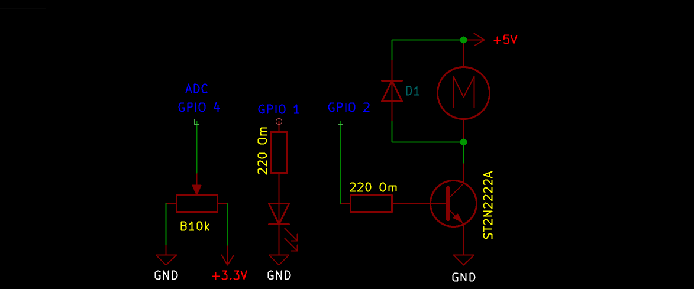

# Керування LED та мотором за допомогою PWM

## Завдання

- Потенціометр керує яскравістю світлодіода.
- Потенціометр керує швидкістю вала двигуна.
- Двигун та світлодіод не впливають на роботу одне одного.

## Схема підключення

## Опис реалізації

Яскравість LED та швидкість обертання мотора керуються одним потенціометром,
значення з якого зчитується через АЦП (ADC1) і масштабується під шпаруватість
(duty cycle) ШІМ-сигналу.

Щоб LED і мотор працювали незалежно один від одного, для кожного з них
налаштовано **окремий таймер LEDC та окремий канал LEDC**:

| Пристрій | Таймер      | Канал            | Частота  | GPIO |
|----------|-------------|------------------|----------|------|
| LED      | `LEDC_TIMER_0` | `LEDC_CHANNEL_0` | 1 кГц    | 1    |
| Мотор    | `LEDC_TIMER_1` | `LEDC_CHANNEL_1` | 20 кГц   | 2    |

**Чому окремі таймер і канал:**
- Кожен LEDC-канал незалежно керує шпаруватістю (duty) свого GPIO, тому зміна
  duty на одному пристрої ніяк не зачіпає інший.
- Мотору потрібна вища частота ШІМ (20 кГц), щоб уникнути чутного гудіння/дзижчання
  обмоток, тоді як для ока частоти 1 кГц цілком достатньо для плавного керування
  яскравістю LED. Використання спільного таймера змусило б обидва пристрої
  працювати на одній частоті, тому таймери також розділені.

