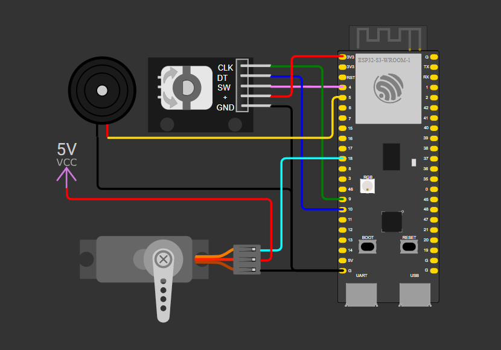

# Керування сервоприводом за допомогою енкодера

## Функціонал

- Обертання енкодера повертає вал сервоприводу на заданий кут у відповідному напрямку (за/проти годинникової стрілки).
- Натискання кнопки енкодера зменшує крок повороту вдвічі — для точнішого налаштування кута.
- Повторне натискання повертає крок до початкового (більшого) значення.
- При спробі повернути вал за межі допустимого діапазону (0–180°) лунає короткий звуковий сигнал (бузер), а кут фіксується на межі.

## Апаратна частина

- ESP32
- Поворотний енкодер з кнопкою 
- Сервопривід SG90
- Пасивний бузер

### Підключення

| Компонент          | Пін ESP32 |
|---------------------|-----------|
| Енкодер A            | GPIO 9    |
| Енкодер B            | GPIO 10   |
| Кнопка енкодера       | GPIO 4    |
| Сигнал сервоприводу   | GPIO 18   |
| Бузер                 | GPIO 5    |

## Реалізація

- Підрахунок імпульсів енкодера — через периферію `PCNT` (Pulse Counter) у режимі квадратури x4.
- Керування сервоприводом та бузером — через `LEDC` (PWM).
- Обробка натискання кнопки — через переривання GPIO з програмним дебаунсом.

